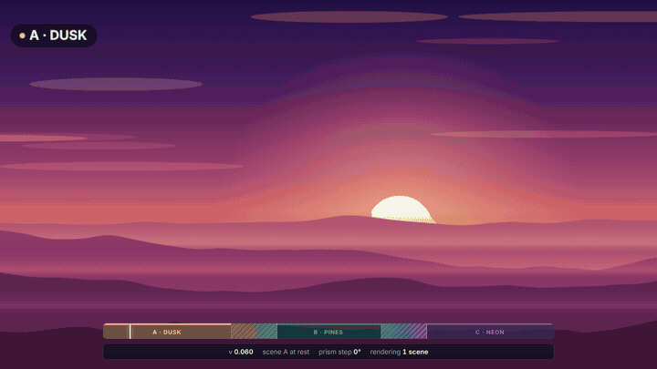
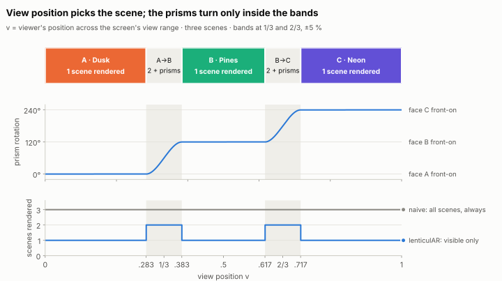
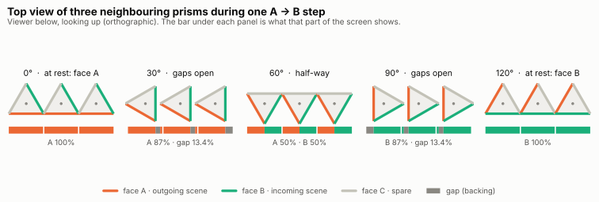
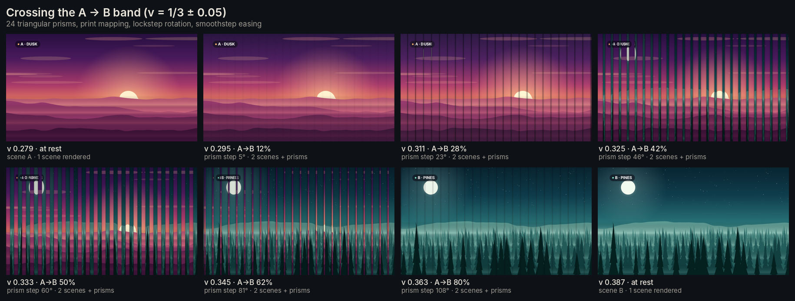
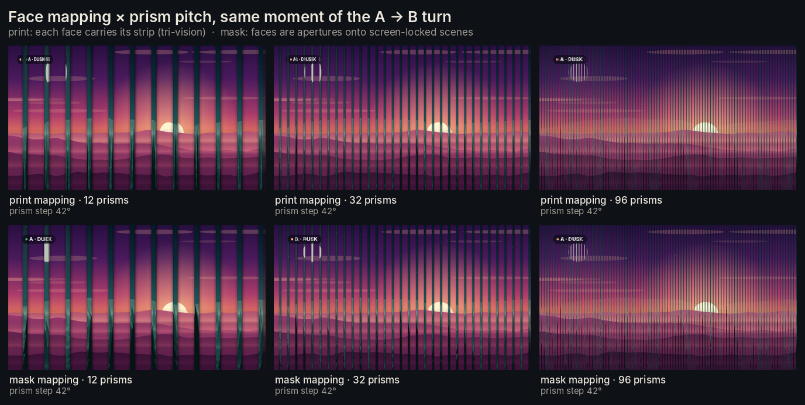
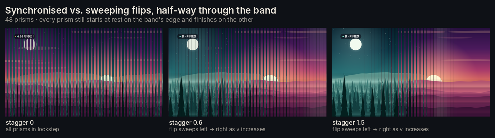

# lenticulAR

## A framework for faking lenticular prints in WebXR

lenticulAR turns an ordinary screen into a lenticular print. Three
depth-mapped scenes — the [pARelax](https://github.com/VeerGoggles/pARelax)
"window" technique — sit behind the glass, and where you stand picks the one
you see. Move across the screen and a row of rotating prisms masks one scene
out and the next one in, the way a lenticular card flips when you tilt it.
Only the scene you can see is rendered: one at rest, two while the prisms
turn.



<sub>Head position swept left → right → left. The strip at the bottom is the
debug HUD: the view range with its rest zones and transition bands, the
viewer's position, and how many scenes were rendered for that frame.
[Full-resolution video](docs/results/sweep.mp4).</sub>

---

## How it works

There are four stages to a lenticulAR frame:

### 1 — Head position → view position (MindAR, as in pARelax)

[MindAR](https://github.com/hiukim/mind-ar-js) face tracking runs in the
browser and gives the viewer's eye position in centimetres. lenticulAR turns
it into a **view position** `v` from 0 (far left) to 1 (far right) by the
*angle* the viewer sees the screen from — like a real lenticular, moving
closer or further away changes nothing, moving sideways does. Mouse or touch
works too: then `v` is simply how far across the screen the pointer is.

### 2 — View zones: one scene, or two in a transition band

<picture>
  <source media="(prefers-color-scheme: dark)" srcset="docs/results/view-zones-dark.svg">
  
</picture>

With three scenes the view range is cut at **1/3** and **2/3**. Around each
cut is a transition band of **±5 %** of the range. Outside the bands exactly
one scene is visible — and it is the only one rendered, straight to the
canvas. Inside a band two scenes are visible, the prisms turn one face
(120°) as the viewer crosses it, and the two scenes go through the prism
compositor.

### 3 — The rotating-prism mask

<picture>
  <source media="(prefers-color-scheme: dark)" srcset="docs/results/prism-cross-section-dark.svg">
  
</picture>

The screen is covered by vertical triangular prisms (24 by default) whose
faces are exactly one strip wide, so at rest they tile the screen. Face A
carries the outgoing scene, face B the incoming one. Per pixel, a full-screen
shader casts an orthographic ray against the pixel's prism and both of its
neighbours (turning prisms overhang their strips), finds the front-most face,
and samples that face's scene — foreshortened like a printed tri-vision slat
(`print` mapping) or screen-locked like a lenticular sheet (`mask` mapping).
Faces are shaded relative to a front-on face, the gaps that open between
turning slats show a dark backing, and every prism turns in lockstep unless a
`stagger` sweeps the flip across the screen.

### 4 — Render only what can be seen

```
┌───────────────────────────────────────────────────────────┐
│  Browser (HTTPS for the camera)                           │
│                                                           │
│   MindAR face tracker ──► eye (cm) ──► view position v    │
│      (or mouse/touch)          │                          │
│                                ▼                          │
│                        view zones                         │
│            at rest ───────┴─────── in a band              │
│               │                       │                   │
│     1 scene ──► canvas      2 scenes ──► 2 sRGB targets   │
│                                       │                   │
│                                       ▼                   │
│                        rotating-prism compositor          │
│                                       │                   │
│                                       ▼                   │
│                                    canvas                 │
│                                                           │
│   every scene: photo + depth map on a displaced plane,    │
│   seen through a head-coupled (off-axis) camera           │
└───────────────────────────────────────────────────────────┘
```

At a band edge the engine switches between the 1-scene path and the
compositor path. The compositor is an exact identity at rest (front-on
shading is exactly 1, the texture is read at the pixel centre, the targets
store sRGB8), so the switch is invisible — measured at ±1/255.

The full derivation — zone maths, prism geometry, shading, the head-coupled
camera and the colour pipeline — is in **[docs/METHOD.md](docs/METHOD.md)**.

---

## Results



| | |
|---|---|
|  |  |

Measured in headless Chromium on the production build
([`scripts/capture_results.py`](scripts/capture_results.py)):

| check | result |
|---|---|
| scenes rendered per frame | **1** in rest zones (801/801 frames), **2** in bands (200/200), never more than 2 |
| render cost vs. drawing every scene every frame | **84 % less at rest**, 70 % less over a full sweep (software WebGL — see RESULTS) |
| shader vs. CPU prism geometry | worst **0.28 %** of a strip (lockstep), 0.23 % (staggered) |
| 1-scene ↔ 2-scene hand-off | max **1/255** per channel — invisible |

Every number, chart and frame is in **[docs/RESULTS.md](docs/RESULTS.md)**.

---

## Usage

The engine is in `src/engine/`. Give it a container element and two to six
`{ map, depthMap, depth?, label? }` scenes — the same descriptors pARelax
takes, with each map a URL, an image/canvas or a `THREE.Texture`:

```js
import { LenticularEngine } from "./engine";

const engine = new LenticularEngine({
  container: containerRef.current,
  scenes: [
    { map: "/dusk.jpg",  depthMap: "/dusk-depth.jpg",  label: "Dusk" },
    { map: "/pines.jpg", depthMap: "/pines-depth.jpg", label: "Pines" },
    { map: "/neon.jpg",  depthMap: "/neon-depth.jpg",  label: "Neon", depth: 0.8 },
  ],
  transitionHalfWidth: 0.05,  // ±5 % of the view range around 1/3 and 2/3
  prism: { count: 24, mapping: "print", stagger: 0 },
  onFrame: (stats) => console.log(stats.v, stats.zone, stats.scenePasses),
});

await engine.start("face");   // or "pointer"; throws if the camera is refused (App.jsx then falls back to pointer)
engine.setOptions({ prism: { count: 48, mapping: "mask" } });   // any option, live
engine.dispose();
```

| option | default | what it does |
|---|---|---|
| `transitionHalfWidth` | `0.05` | half-width of each transition band, as a fraction of the view range |
| `boundaries` | `k / N` | where one scene hands over to the next (`[1/3, 2/3]` for three) |
| `easing` | `"smoothstep"` | prism rotation across a band: `linear`, `smoothstep`, `smootherstep` |
| `prism.count` | `24` | prisms across the screen |
| `prism.mapping` | `"print"` | `"print"` (faces carry their strip) or `"mask"` (screen-locked), or 0–1 |
| `prism.stagger` | `0` | 0 = every prism turns in lockstep; > 0 sweeps the flip left → right |
| `prism.direction` | `1` | which side the incoming face swings in from |
| `prism.shading` / `specular` / `crease` | `0.45` / `0.15` / `0.35` | face lighting while turning (all exactly neutral at rest) |
| `prism.gapColor` / `gapFill` | `#07060d` / `0.3` | what shows between turning prisms |
| `prism.samples` | `4` | horizontal supersamples per pixel |
| `viewConeDeg` | `40` | viewing angle mapped onto v = 0…1 (face tracking) |
| `parallax` | `0.6` | gain on head movement for the parallax camera |
| `smoothingMs` | `70` | head-position smoothing time constant |
| `scheduling` | `"lazy"` | `"lazy"`: visible scenes only · `"always"`: every scene, every frame (baseline) |
| `display` | estimated | `{ widthCm, viewerDistanceCm, backCm, reliefCm }` physical model |

`depth` per scene scales its relief, as in pARelax. Depth maps follow the
MiDaS convention (white = near) — generate them as described in the
[pARelax README](https://github.com/VeerGoggles/pARelax#1--depth-estimation-with-midas).

The demo (`src/App.jsx`) draws three colour + depth pairs at runtime
(`src/demo/demoScenes.js`), so no assets are bundled. It has a live control
panel (**C**), the debug HUD (**H**), arrow-key nudging in mouse mode and
fullscreen (**F**). Query parameters set the same options:
`?tracking=pointer&prisms=48&mapping=mask&stagger=0.6&band=0.05&hud=1`.

---

## Getting started

```
npm install
npm start      # HTTPS is required for camera access
npm test       # zone maths, prism geometry, face-matrix decoding
npm run build
```

mind-ar depends on the native `canvas` package for its Node-side tools. If
that fails to build on your machine, `npm install --ignore-scripts` — nothing
in the browser build uses it (CI installs this way).

Regenerate everything in `docs/results/` from a build:

```
pip install -r scripts/requirements.txt && python -m playwright install chromium
python scripts/capture_results.py   # frames, animation (needs ffmpeg), verification, benchmark
python scripts/make_figures.py      # charts and diagrams, light + dark
```

`.github/workflows/pages.yml` tests and builds every push and pull request,
and publishes `main` to GitHub Pages — at
<https://veergoggles.github.io/lenticulAR/> — once Pages is enabled under
*Settings → Pages → Source: GitHub Actions* (until then the deploy step is
skipped with a notice). Pages serves over HTTPS, so the camera works there,
including on phones.

---

## Layout

```
src/
  engine/
    LenticularEngine.js   frame loop, scheduling, render targets
    viewZones.js          v → zones, bands, prism angle, schedule   (pure, tested)
    prismGeometry.js      prism cross-section, ray casting, shading (pure, tested)
    PrismCompositor.js    the rotating-prism mask, in GLSL
    ParallaxScene.js      photo + depth map on a ray-displaced plane
    headCoupledCamera.js  off-axis projection
    trackers.js           MindAR face, pointer, manual
  demo/demoScenes.js      procedural colour + depth pairs
  App.jsx, Hud.jsx, ControlPanel.jsx
scripts/                  results harness and figures
docs/METHOD.md            the maths
docs/RESULTS.md           measurements and frames
```

lenticulAR is a sibling of [pARelax](https://github.com/VeerGoggles/pARelax)
and keeps its stack (React 18, Three.js r161, MindAR, react-app-rewired with an
HTTPS dev server). What changed and why is in
[METHOD.md § Differences from pARelax](docs/METHOD.md#7-differences-from-parelax) — including a fix
worth porting back: pARelax reads MindAR's row-major face matrix with
`Matrix4.fromArray`, so its camera never follows the head.
