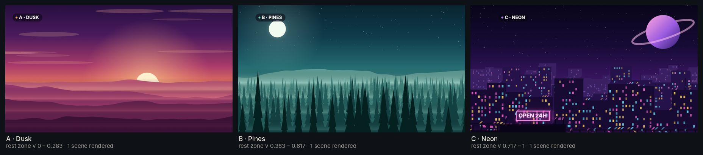
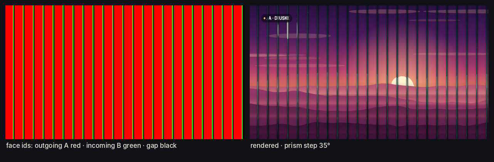
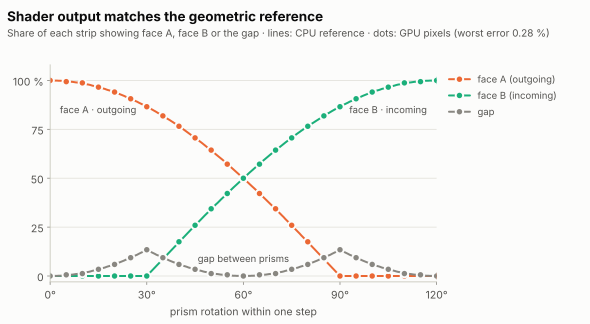
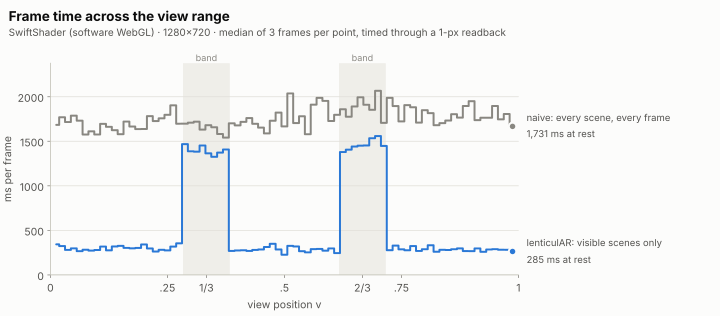

# Results

Everything on this page is produced by
[`scripts/capture_results.py`](../scripts/capture_results.py) and
[`scripts/make_figures.py`](../scripts/make_figures.py) from the production
build, in headless Chromium at 1280 × 720 (device pixel ratio 1), through the
deterministic `?capture=1` hooks: `window.lenticulAR.frame(v)` renders exactly
one frame at view position `v`, with smoothing off. WebGL runs on
**SwiftShader**, Chromium's software rasteriser, so the run is reproducible on
any machine — and so absolute timings are those of a CPU, not a GPU (see
[Render cost](#render-cost)).

Defaults throughout unless a caption says otherwise: three scenes, bands at
1/3 and 2/3 with a ±0.05 half-width, 24 triangular prisms, print mapping,
lockstep rotation, smoothstep easing, 4 horizontal supersamples.

---

## The three scenes at rest

Procedural colour + depth pairs (`src/demo/demoScenes.js`), each the only
scene rendered anywhere in its rest zone.

## One transition, frame by frame

Entering the band, thin dark gaps open between the slats (the prisms have
started to turn; nothing of B is visible yet). Past ~30° of rotation the
incoming face swings into view from the right of each slat, foreshortened;
half-way (60°) each slat is half A, half B; then A thins out to a sliver and
the gaps close again as B comes front-on. Just outside the band the frame is
B alone, from the 1-scene path.

## The sweep

[`sweep.mp4`](results/sweep.mp4) is the same capture at full resolution
(1280 × 720, 30 fps). The view position moves 0.06 → 0.94 → 0.06, slowing to
a third of its speed inside the bands so the turns can be followed. The HUD
shows the zones, the viewer's position (white marker), the transition
progress, the prism step angle, and whether one scene or two scenes + the
prism pass were rendered.

## Face mapping and prism pitch

Same instant of the A → B turn. **Print** faces carry their own strip, so the
picture on a turning face is foreshortened (look at the sun); **mask** faces
are apertures onto screen-locked scenes, so each scene stays exactly where it
is and only the slats move. At 96 prisms either reads as the fine interleaved
"ghost" of a real lenticular flip; at 12 it reads as a tri-vision billboard.

## Lockstep vs. sweeping flips

Half-way through the band. With `stagger > 0` the flip runs across the screen
in the direction the viewer moves, as it does on a real lenticular sheet seen
from close up; every prism still starts on the band's first edge and finishes
on its last.

## What the mask is doing

`?debug=faces` replaces each face with a flat id colour: outgoing face red,
incoming face green, gap black.

---

## Verification

### GPU output vs. the geometric reference

<picture>
  <source media="(prefers-color-scheme: dark)" srcset="results/coverage-dark.svg">
  
</picture>

With `debug=faces`, 16 prisms and linear easing, the share of red, green and
black in the twelve inner strips was measured from the canvas (sRGB-decoded,
so partially covered pixels count fractionally) every 5° through a step and
compared with `faceCoverage()` from `prismGeometry.js`, which casts 8 000 rays
per strip:

| rotation | face A GPU / CPU | face B GPU / CPU | gap GPU / CPU | error |
|---:|---:|---:|---:|---:|
| 0° | 100.0 / 100.0 % | 0.0 / 0.0 % | 0.0 / 0.0 % | 0.00 % |
| 15° | 96.6 / 96.6 % | 0.0 / 0.0 % | 3.4 / 3.4 % | 0.02 % |
| 30° | 86.6 / 86.6 % | 0.0 / 0.0 % | 13.4 / 13.4 % | 0.04 % |
| 45° | 70.6 / 70.7 % | 25.9 / 25.9 % | 3.4 / 3.4 % | 0.07 % |
| 60° | 50.0 / 50.0 % | 50.0 / 50.0 % | 0.0 / 0.0 % | 0.00 % |
| 75° | 25.9 / 25.9 % | 70.6 / 70.7 % | 3.4 / 3.4 % | 0.07 % |
| 90° | 0.0 / 0.0 % | 86.6 / 86.6 % | 13.4 / 13.4 % | 0.04 % |
| 105° | 0.0 / 0.0 % | 96.6 / 96.6 % | 3.4 / 3.4 % | 0.02 % |
| 120° | 0.0 / 0.0 % | 100.0 / 100.0 % | 0.0 / 0.0 % | 0.00 % |

Worst disagreement over all 25 angles: **0.28 % of a strip** (one strip is 80 px wide here, so that is a fraction of a pixel).

### Staggered flips, prism by prism

With `stagger` the prisms turn by different amounts, so the check is per prism: at the middle of the band, each inner prism's A / B / gap shares were measured on the GPU and compared with `castScreen()` using that prism's own rotation from `prismProgress()`.

| stagger | prisms checked | local progress range | worst error |
|---:|---:|---|---:|
| 1 | 14 | 0.09 – 0.91 | 0.21 % |
| -0.6 | 14 | 0.26 – 0.74 | 0.23 % |

### The 1-scene ↔ 2-scene hand-off is invisible

At rest the engine draws one scene straight to the canvas; in a band it draws two into sRGB8 targets and composites them. Forcing the compositor at rest (`scheduling: "always"`) and diffing it against the direct path, and diffing the frames on either side of each band edge:

| comparison | max per-channel difference | pixels that differ at all |
|---|---:|---:|
| v = 0.1: direct vs. composited | 1 / 255 | 0.29 % |
| v = 0.5: direct vs. composited | 1 / 255 | 0.26 % |
| v = 0.9: direct vs. composited | 1 / 255 | 0.10 % |
| A→B start: 1-scene vs. 2-scene frame | 1 / 255 | — |
| A→B end: 1-scene vs. 2-scene frame | 2 / 255 | — |

One level in 255 is the rounding of the sRGB round trip; nothing visible changes when the path switches.

### Never more than two scenes

Rendering 1001 frames from v = 0 to 1 and counting the scene passes the engine actually issued: **801 of 801** rest-zone frames drew exactly one scene, **200 of 200** band frames drew exactly two, and no frame drew more than **2**.

---

## Render cost

<picture>
  <source media="(prefers-color-scheme: dark)" srcset="results/render-cost-dark.svg">
  
</picture>

| | at rest (80 % of the range) | in a band (20 %) | mean over a sweep |
|---|---:|---:|---:|
| **lenticulAR** (visible scenes only) | 285 ms · 1 scene | 1424 ms · 2 scenes + prisms | 521 ms |
| naive (every scene, every frame) | 1731 ms · 3 scenes + prisms | 1714 ms · 3 scenes + prisms | 1757 ms |
| saving | **84 %** | 17 % | **70 %** (3.4× faster) |

Median of 3 frames at each of 79 view positions, 1280 × 720, each frame timed through a one-pixel `readPixels` so the GPU work is included (`gl.finish()` does not wait in Chrome). Renderer: `ANGLE (Google, Vulkan 1.3.0 (SwiftShader Device (Subzero) (0x0000C0DE)), SwiftShader driver)`.

These are **software-rendering** times — useful as ratios, not as absolute numbers. On a GPU every pass is far cheaper, but the shape is the same: at rest lenticulAR draws one scene where the naive schedule draws three plus a full-screen prism pass, and in a band it saves one of the three scene passes.

The raw numbers are in [`benchmark.json`](results/benchmark.json) and
[`verification.json`](results/verification.json).
